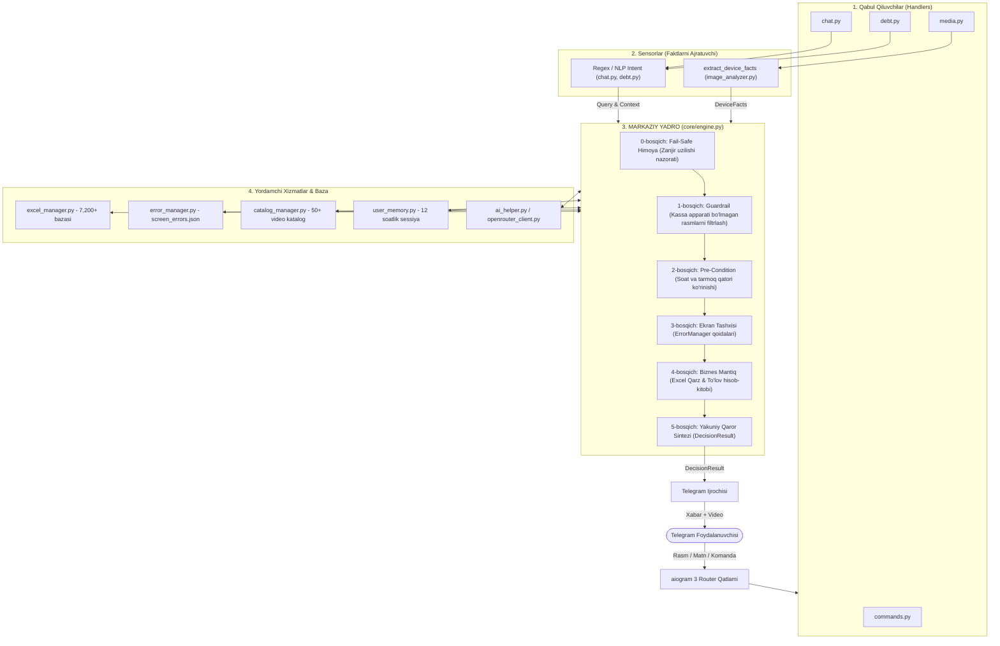

# 🏛 «Mars POS Assistant» — Tizim Arxitekturasi va Dasturlash Standartlari

Ushbu hujjat loyihaning texnik arxitekturasi, ma'lumotlar oqimi, qarorlar qabul qilish Yadrosi (**Core Decision Engine**), xotira tizimi hamda loyihani kelgusida buzmasdan kengaytirish (**Extensibility Guide**) qoidalarini belgilaydi.

---

## 1. Arxitektura Falsafasi va Tamoyillari

Loyiha **Domain-Driven Design (DDD)** hamda **Pipeline / Orchestrator Pattern** tamoyillariga asoslangan:

1. **Yadro Ustuvorligi (Core-Centric):**
   Hech bir Telegram handler (qabul qiluvchi) o'zboshimchalik bilan biznes qaror chiqarmaydi, if-else lab ketmaydi. Barcha mantiqiy qarorlar markaziy Yadro (`core/engine.py`) tomonidan qabul qilinadi.
2. **Sensorlar va Ijrochilar Ajratilishi (Sensory vs Execution Separation):**
   Rasm tahlilchisi (`image_analyzer.py`) faqat tasvirdan sof faktlarni ajratadi (Sensor). Handlerlar (`handlers/`) esa Yadroning qarorini Telegramga yetkazadi (Runner).
3. **Kengaytirish uchun ochiq, buzish uchun yopiq (Open-Closed Principle):**
   Yangi ekran xatoligi yoki yangi buyruq qo'shilganda mavjud kodlarga tegish shart emas. Yangi modul zanjirga yangi filtr yoki qoida sifatida xavfsiz ulanadi.
4. **Zanjir uzilishidan himoya (Fault-Tolerant & Fail-Safe):**
   Tashqi servislar (AI API, internet, Excel o'qish) uzilib qolsa ham bot qulab tushmaydi, xavfsiz zaxira ssenariysiga o'tadi.

---

## 2. Tizimning Blok Diagrammasi



---

## 3. Qaror Qabul Qilish Algoritmi (Pipeline Bosqichlari)

Yadroga kelgan har bir so'rov 6 ta qat'iy bosqichdan o'tadi:

### 0-bosqich: Fail-Safe (Zanjir uzilishidan himoya)
* **Holat:** AI API javob bermay qolsa, tarmoq uzilsa (timeout, 504), rasm buzilgan bo'lsa.
* **Xatti-harakat:** Dastur to'xtamaydi. Agar rasm izohida INN bo'lsa, qarz bazadan tekshiriladi. Bo'lmasa:
  > *"⚠️ Tasvirni to'liq tahlil qilib bo'lmadi. Iltimos, apparat ekranini to'liqroq rasmga oling yoki INN raqamini yozing."*

### 1-bosqich: Guardrail (Begona rasmlar)
* **Qoida:** Rasmda Smart POS apparati yoki kassa ekrani bormi?
* **Xatti-harakat:** Agar kassa apparati bo'lmasa (hayvon, taom, tabiat, shaxsiy fotosurat, daftar va h.k.) va ekranda INN ham yo'q bo'lsa -> `ActionType.IGNORE` (bot mutlaqo javob bermaydi, jim turadi).

### 2-bosqich: Pre-Condition (Status Bar talabi)
* **Qoida:** Ekran tepasidagi soat va tarmoq qatori to'liq tushganmi?
* **Xatti-harakat:** Agar status bar kesilgan bo'lsa -> `ActionType.ASK_FULL_SCREEN`:
  > *"⚠️ Ekranning tepa qismi (soat va tarmoq qatori) ko'rinmayapti. Aniq tashxis qo'yishimiz uchun apparat ekranining yuqori qismidagi soat va internet belgisi tushgan holda qayta rasm yuboring."*

### 3-bosqich: Ekran Tashxisi (Error Diagnostics)
* **Qoida:** Status bar to'liq bo'lsa, `error_manager.py` qoidalari bo'yicha tashxis qilinadi:
  * Soat Toshkent vaqtidan 10 daqiqadan ko'pga farq qilsa -> 🎬 **Video 141** (Soatni to'g'rilash).
  * Internet (Wi-Fi/SIM) yo'q bo'lsa -> Internetni tekshirish ko'rsatmasi.
  * Fiskal modul xatosi -> 🎬 **Video 134 / 137**.
  * Dastur yangilash talabi -> 🎬 **Video 125**.
  * Lenta (qog'oz) tugagan -> Lenta solish eslatmasi.

### 4-bosqich: Biznes & Excel Integratsiyasi
* **Qoida:** Ekranda yoki matnda INN topilsa, `excel_manager.py` dan qidiriladi.
* **Xatti-harakat:**
  * Agar qarz bo'lsa:
    * `Shu oy ishlashi uchun:` joriy qarz summasi.
    * `Yil oxirigacha ishlashi uchun:` joriy qarz + qolgan oylarning to'lovi.
    * 🎬 **Video 148** (Click orqali to'lash videosi).
  * Agar qarz bo'lmasa:
    * Qarzdorlik yo'qligi va ortiqcha to'lov summasi ko'rsatiladi.

### 5-bosqich: Yakuniy Sintez (Synthesis)
Ekran tashxisi va qarz hisobi bitta lo'nda javobga jamlanib, `DecisionResult` obyekti sifatida handlerga uzatiladi.

---

## 4. Xotira va Ko'p Foydalanuvchili Kontekst (`user_memory.py`)

Guruhlarda bir necha kishi bir vaqtda gaplashganda chalkashmaslik uchun quyidagi tizim ishlaydi:
* **Izolyatsiya kaliti:** `chat_id:user_id` (Masalan: `-100999888:1001` va `-100999888:1002`).
* **Sessiya muddati (TTL):** 12 soat. Eskirgan sessiyalar xotiradan avtomatik tozalanadi.
* **Saqlanadigan ma'lumotlar:**
  * `last_id`: Foydalanuvchi qidirgan oxirgi INN/JSHSHIR raqami.
  * `debt_info`: Korxona nomi va oxirgi hisoblangan qarz summasi.
  * `last_topic`: Oxirgi muhokama qilingan mavzu (`time_error`, `fiscal_module`, `debt_checked`).
  * `history`: Oxirgi 6 ta muloqot zanjiri.

---

## 5. Yangi Feature / Modul Qo'shish Qo'llanmasi

Kelgusida loyihani buzmasdan yangi funksiya qo'shish uchun quyidagi qat'iy qoidalarga amal qilinadi:

### 1-Misol: Yangi Buyruq (Command) qo'shish
*Faqat* `handlers/commands.py` fayliga yangi funksiya yoziladi:
```python
@router.message(Command("yangi_buyruq"))
async def cmd_yangi_buyruq(message: types.Message):
    await message.answer("Yangi buyruq muvaffaqiyatli ishladi!")
```
*Hech qaysi boshqa faylga yoki `bot.py` ga teginish shart emas.*

### 2-Misol: Ekrandagi yangi nosozlik (Error Rule) qo'shish
*Faqat* `data/screen_errors.json` fayliga yangi qoida kiritiladi:
```json
{
  "id": "battery_low",
  "name": "Batareya quvvati past",
  "screen_keywords": ["quvvat past", "low battery", "batareya"],
  "response_text": "⚠️ <b>Kassa apparati quvvati kam qolgan.</b> Iltimos, quvvatlagichga ulang.",
  "video_id": null,
  "require_inn": false
}
```
*Yadroning o'zi ushbu yangi qoidani avtomatik taniydi va ishga tushiradi.*

### 3-Misol: Yangi Video-qo'llanma qo'shish
*Faqat* `data/video_catalog.json` fayliga yangi post qo'shiladi:
```json
{
  "id": 150,
  "title": "Kassada chekni bekor qilish (Vozvrat)",
  "keywords": ["vozvrat", "bekor qilish", "chekni qaytarish", "qaytuv"],
  "description": "Chekni bekor qilish videosi"
}
```
*Yoki kanalga yangi video tashlansa, bot uni AI orqali avtomatik indekslab o'zi qo'shib oladi.*

---

## 6. Yangi Modullar: Kvitansiya va Admin Eskalatsiyasi

### A. Kvitansiya Tahlil Moduli (`receipt_analyzer.py`)
- **Formatlar:** Rasm (`photo`) yoki PDF (`.pdf` document).
- **Sensory Extractor:** `pypdf` va OpenRouter multimodal orqali kvitansiyadan to'lov faktlarini ajratadi:
  - Qabul qiluvchi hisob raqami (Mars: `20208000800208044003`).
  - To'langan summa (float).
  - To'lovchi INN/JSHSHIR raqami, chek ID, sana, to'lov tizimi (Click, Payme, Bank).
- **Yadroda qarz bilan solishtirish:**
  - Agar `to'lov >= qarz` bo'lsa -> Qarzdorlik to'liq yopilgani qayd etiladi va adminga apparatni faollashtirish buyrug'i yuboriladi.
  - Agar `to'lov < qarz` bo'lsa -> Qisman to'lov deb belgilanadi, qolgan qarz ko'rsatiladi.
  - Agar INN topilmasa -> Kvitansiya vaqtincha xotirada saqlanadi (`pending_receipt`) va foydalanuvchidan INN so'raladi.

### B. Admin Moduli va Eskalatsiya (`admin_manager.py`, `handlers/admin.py`)
- **Adminlar va kontaktlar:**
  - `.env` va `data/admin_config.json` orqali admin Telegram ID lari va mas'ul mutaxassislar kontaktlari boshqariladi.
  - Buyruqlar: `/admin`, `/statistika`, `/admins`, `/add_admin`, `/contacts`, `/add_contact`.
- **Eskalatsiya holatlari (Avtomatik adminga yuborish):**
  1. **Kvitansiya kelganda:** Yangi to'lov summasi, korxona nomi, INN, qarz yopilgani va chek nusxasi bilan birga barcha adminlarga hisobot uzatiladi.
  2. **Texnik nosozlik (Internet bor + Qarz yo'q):** Agar apparatda internet ishlab turgan bo'lsa, qarz bo'lmasa, lekin ekranda nosozlik bo'lsa -> Bot muammoni adminga rasm bilan yetkazadi va mijozga mas'ul xodim kontaktlarini beradi.
  3. **Mijoz yordam so'raganda:** "operator kerak", "usta yuboring", "hal bo'lmadi" so'zlari yozilganda adminga bildirishnoma boradi.

---

## 7. Loyiha Fayllari Mundarijasi

| Fayl / Papka | Vazifasi |
| :--- | :--- |
| `core/engine.py` | 🧠 Markaziy Yadro (Qarorlar chiqaruvchi orkestrator) |
| `core/rule_engine.py` | 🔌 Modulli Patch va Qoidalar Dvigateli (Plug & Play Rule Engine) |
| `data/custom_patches.json`| 📑 Deklarativ mayda patchlar bazasi (kodga tegmasdan yangi shartlar qo'shish) |
| `core/models.py` | 📦 Ma'lumot modellari (`DeviceFacts`, `ReceiptFacts`, `DecisionResult`, `ActionType`) |
| `admin_manager.py` | 👨‍💻 Adminlar, mas'ul xodimlar kontaktlari va bildirishnomalar (Escalation) boshqaruvchisi |
| `receipt_analyzer.py`| 🧾 To'lov kvitansiyalari (rasm / PDF) faktlarini ajratuvchi Sensor |
| `handlers/admin.py` | ⚙️ Admin boshqaruv paneli (`/admin`, `/statistika`, `/admins`, `/contacts`) |
| `handlers/commands.py` | 🕹 Barcha Telegram komandalar (`/start`, `/help`, `/tekshir`, `/tolov`, `/tarix`) |
| `handlers/debt.py` | 💳 Qarz tekshiruvi (INN) va to'lov tarixi so'rovlari |
| `handlers/media.py` | 📸 Ekran rasmlari, to'lov kvitansiyalari (rasm/PDF) va Excel yangilash |
| `handlers/chat.py` | 💬 Erkin matnli muloqot, video katalog va operator eskalatsiyasi |
| `handlers/channel.py` | 📢 Kanaldan postlarni forward qilish va avto-indekslash |
| `image_analyzer.py` | 👁 Kassa ekrani tasviridan sof faktlarni ajratuvchi Sensor |
| `excel_manager.py` | 📊 7,200+ korxona bazasi, qarz va to'lovlar hisob-kitobi |
| `error_manager.py` | ⚙️ Ekran xatoliklari qoidalari dispetcheri |
| `catalog_manager.py` | 🎬 50+ video postlar qidiruv mexanizmi |
| `user_memory.py` | 💾 Ko'p foydalanuvchili 12 soatlik sessiya va pending kvitansiya xotirasi |
| `openrouter_client.py`| ⚡️ Gemini 3.5 Flash Lite modeli bilan barqaror aloqa |
| `bot.py` | 🚀 Botni ishga tushiruvchi ixcham dastur |

---

## 8. Modulli Qoidalar va Mayda Patchlar Tizimi (Plug & Play Rule Engine)

### Nega bu arxitektura joriy etildi?
Ilgari botga mayda shartlar (masalan: *"Wi-Fi parolini qayerdan o'zgartirish kerak?", "quloqchin bormi?", "lenta qayerdan olinadi?"*) to'g'ridan-to'g'ri `handlers/chat.py` yoki `core/engine.py` ichidagi if/elif zanjiriga kiritilardi. Bu esa asosiy biznes mantig'ini (INN qarz tekshiruvi, 406 xatolik, kvitansiyalar, eskalatsiya) buzib qo'yardi yoki regressiyalarga olib kelardi.

### Yangi yechim:
1. **Yakkalangan maydon (Blast Radius = 0):**
   Yangi qoidalar `core/rule_engine.py` orqali yoki `data/custom_patches.json` da bitta JSON obyekti sifatida qo'shiladi.
2. **Prioritet zanjiri (Priority Ordering):**
   - `90 - 100`: Favqulodda override yoki qat'iy shartlar.
   - `70 - 89`: Mayda patchlar, savol-javoblar (`data/custom_patches.json`).
   - `10 - 40`: Fallback va umumiy tavsiyalar.
3. **Xatolikdan himoya qalqoni (Crash Isolation):**
   Bitta yangi kiritilgan patchda xatolik bo'lsa ham, `RuleEngine` uni logga yozadi va asosiy 4 bosqichli yadro o'z ishini hech to'xtovsiz davom ettiradi.
4. **Kodga tegmasdan deklarativ patch qo'shish:**
   `rule_engine.add_patch(patch_id, keywords, reply_text, priority)` orqali yoki to'g'ridan-to'g'ri `data/custom_patches.json` ga yozish orqali yangi javoblar bir zumda ishga tushadi.

